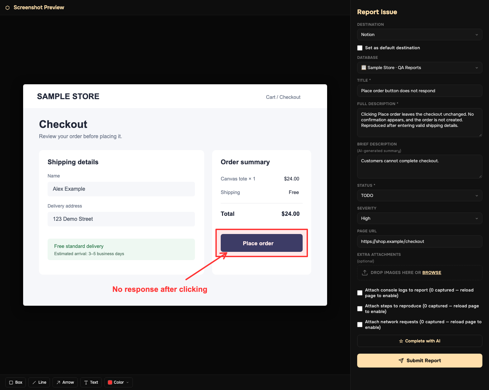

# MDEV QA Reporter

A Chrome extension for capturing, annotating, and submitting actionable bug reports to Notion or Google Docs, with optional AI assistance powered by Cloudflare Workers AI.



*Report editor demo with fictional checkout data. No live report was submitted.*

## Features

- Capture a page region by dragging, or click an element to capture it.
- Annotate screenshots with boxes, lines, arrows, and text; choose colors and undo edits.
- Include screenshots, extra image attachments, page URLs, and optional captured console logs, interaction steps, and network requests.
- Submit reports to an accessible Notion database or append them to a Google Doc.
- Record browser, operating system, and submission time in report details.
- Optionally generate a title, brief description, and severity from your description using Workers AI.

## Project structure

| Path | Purpose |
| --- | --- |
| `mdev-src/` | Manifest V3 extension, popup, capture tools, and report editor |
| `cloudflare-worker/` | Optional authenticated Workers AI endpoint |
| `cloudflare-worker/test/` | Worker and extension tests using Node's built-in test runner |
| `docs/images/` | README screenshots |

## Install the extension

1. Clone this repository.
2. Copy the configuration template:

   ```sh
   cp mdev-src/config.example.js mdev-src/config.local.js
   ```

3. For Notion, fill in the local configuration as described below. Google Docs reports do not require a Notion token.
4. Open `chrome://extensions`, enable **Developer mode**, select **Load unpacked**, and choose `mdev-src/`.
5. Reload the webpage you want to test so capture of logs, steps, and requests starts on that page.

The extension needs no build step. Use a regular webpage: Chrome restricts extension access to pages such as `chrome://` URLs and the Chrome Web Store.

## Configure report destinations

### Notion

Create a Notion integration with permission to read the target database, create report pages, and upload attachments. Give the integration access to the database, then enter its token in `mdev-src/config.local.js`:

```js
globalThis.MDEV_CONFIG = {
  notionApiKey: 'YOUR_NOTION_INTEGRATION_TOKEN',
  notionDatabaseId: '' // Optional fallback database ID.
};
```

Reload the extension after changing this file. The editor lists accessible databases and tries to select one matching the captured site's hostname or title.

The destination database must have these properties:

| Property | Notion type / values |
| --- | --- |
| `Title` | Title |
| `Status` | Status: `TODO`, `In Progress`, `In Review`, `Completed` |
| `Severity` | Status: `Low`, `Medium`, `High` |
| `Brief description` | Rich text |
| `Page URL` | URL |

The last two properties are sent when those report fields are populated. Missing credentials produce a setup message; Google Docs remains available.

### Google Docs

1. Use a Google Cloud project with the Google Docs API and Google Drive API enabled.
2. Configure a Chrome extension OAuth client for the extension ID shown at `chrome://extensions`. Set the client ID in `mdev-src/manifest.json` under `oauth2.client_id`. Configure consent/test users as appropriate for your project.
3. Reload the extension, open its popup, and paste a target Google Doc URL or document ID. It saves automatically.
4. Choose **Google Docs** in the report editor. The first submission prompts for Google authorization; use an account that can edit the document.

The manifest includes a public extension key to keep its development ID stable. It is not a private signing key. Changing that public key changes the extension ID and requires updating OAuth configuration and the Worker's allowed origin.

Google Docs submission uploads report images to Drive and grants **anyone with the link** reader access so Docs can insert them. Use sample or shareable content for this workflow.

## Optional AI assistance

With Node.js 22 or newer, install and deploy the Worker following [the Worker setup guide](cloudflare-worker/README.md). It covers Cloudflare authentication, the `AI_ENDPOINT_TOKEN` secret, allowed extension origin, local development, and the API.

In the extension popup, enter the deployed `https://<worker>.<subdomain>.workers.dev` URL and matching endpoint token, then select **Save AI settings** and grant access to that hostname. These settings are stored locally on the device.

In the editor, enter a description longer than 10 characters and select **Complete with AI**. Review the generated fields before submitting. AI assistance is optional; reports can be completed manually.

## Submit a report

1. Open the extension popup and select **Capture Screenshot**.
2. Drag over the desired area, or click an element.
3. Annotate the capture, enter a title and description, and choose status and severity.
4. Choose the destination and database or configure your target Google Doc.
5. Select any logs, steps, requests, or image attachments you want included.
6. Review the report and select **Submit Report**.

Captured diagnostic data may contain page content or request details. Review what you include before submitting it to a destination.

## Development and verification

```sh
cd cloudflare-worker
npm ci
npm test
npx wrangler deploy --dry-run
```

Tests mock extension APIs, network calls, and AI inference. They cover screenshot annotations, report metadata, destination payloads, AI configuration and generation, authentication, CORS, and error handling. Live integration setup still needs a manual check with your own accounts.

## Local files and credentials

Git ignores local environment files (`.env*`, `.dev.vars*`), `config.local.js`, private keys and certificates, archives (including ZIP files), extension packages, dependencies, Wrangler state, and local tooling files. Keep real credentials in those local files or service secret stores, and use the committed example for a fresh checkout.

The repository includes public configuration identifiers used by the extension and Worker. Use your own Cloudflare account ID in `cloudflare-worker/wrangler.jsonc` before deployment. Never place a private signing key or service credential in publishable source.
